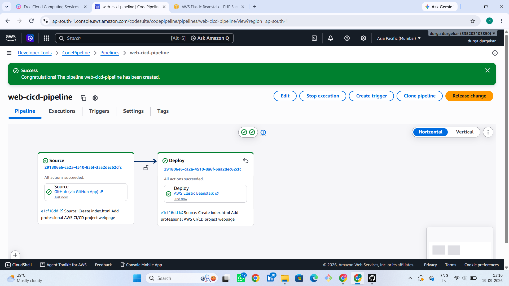
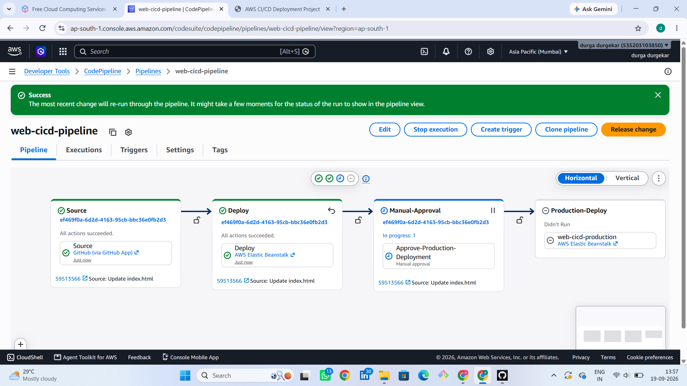
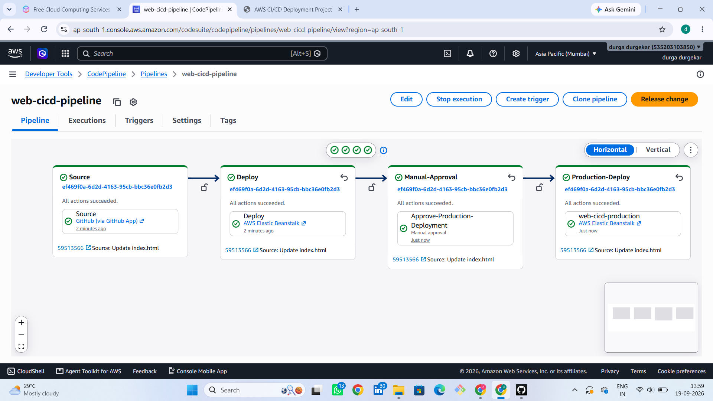
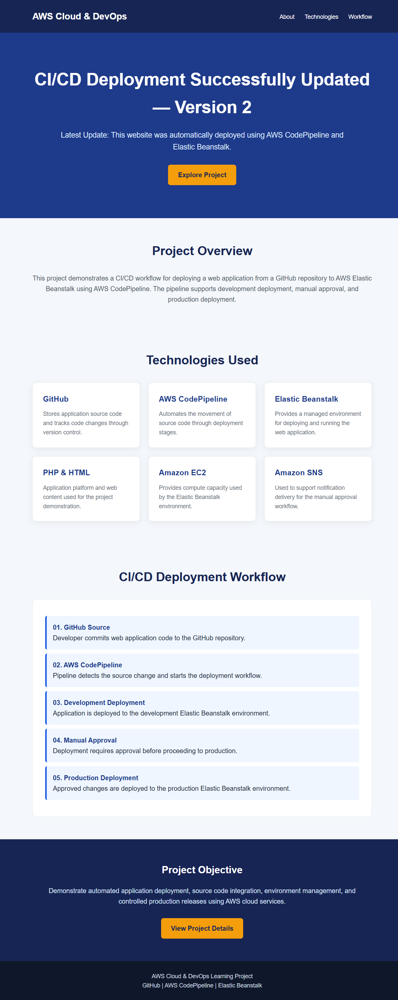
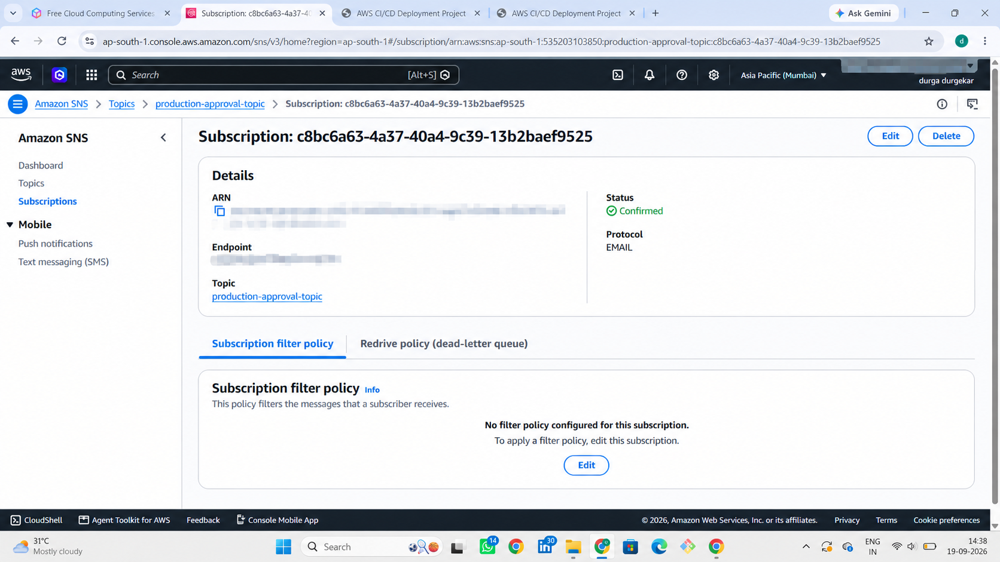

# Automated Web Application Deployment Using AWS CI/CD Pipeline

## 📌 Project Overview

This project demonstrates automated web application deployment using AWS CodePipeline, GitHub, and AWS Elastic Beanstalk.

The pipeline automatically deploys website changes to the development environment and uses manual approval before deploying to production.

## 🏗️ Architecture

GitHub → AWS CodePipeline → Development Environment → Manual Approval → Production Environment

## 🛠️ Technologies Used

- GitHub
- AWS CodePipeline
- AWS Elastic Beanstalk
- PHP Platform
- HTML
- AWS EC2
- AWS SNS (Optional Notifications)

## ⚙️ Project Workflow

1. Created a GitHub repository for the web application.
2. Developed a professional HTML website.
3. Created a development environment using AWS Elastic Beanstalk.
4. Connected GitHub with AWS CodePipeline.
5. Configured automatic source deployment.
6. Tested automatic deployment by updating website content.
7. Created a production Elastic Beanstalk environment.
8. Added a manual approval stage.
9. Deployed the application to production after approval.
10. Verified the production website.

## ✅ Key Features

- Automated deployment from GitHub
- Development environment testing
- Manual approval before production deployment
- Production deployment using AWS Elastic Beanstalk
- Continuous integration and continuous delivery workflow

## 🎯 Project Objective

To implement a basic CI/CD pipeline that automates web application deployment and introduces controlled production releases using AWS services.

## 👩‍💻 Author

Durga Durgekar

BSc Computer Science
---

## 📸 Project Screenshots

The following screenshots demonstrate the AWS CI/CD deployment workflow, manual approval process, production deployment, and SNS notifications.

### 1. AWS CodePipeline Execution Success

### 2. Development Website Deployment

### 3. Pipeline Manual Approval

### 4. Production Deployment Success

### 5. Production Website Verification

### 6. SNS Email Subscription Confirmation

